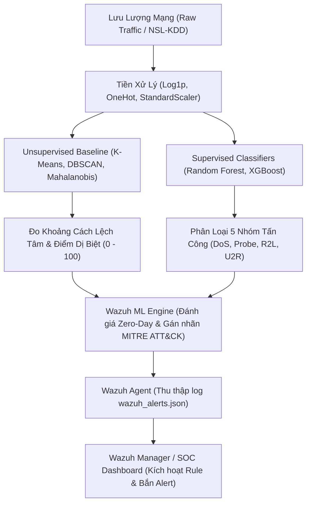

# 🛡️ Network Intrusion & Cyber Attack Detection (ML-NIDS)
### Hybrid Unsupervised Distance Anomaly Detection & Supervised Classification with Wazuh SIEM Homelab Integration

> **Chào bạn! Đừng lo lắng nếu mới bắt đầu tiếp cận đề tài này.**  
> Tài liệu này được biên soạn để dẫn dắt bạn đi từ **bức tranh tổng thể (tại sao lại làm như vậy)** đến **chi tiết từng bước thuật toán**, và cuối cùng là **cách gắn trực tiếp vào hệ thống SOC Wazuh Homelab** mà bạn đang sở hữu.

---

## 📌 MỤC LỤC
1. [Bức Tranh Tổng Thể (The Big Picture)](#1-bức-tranh-tổng-thể-the-big-picture)
2. [Khảo Sát Bộ Dữ Liệu NSL-KDD](#2-khảo-sát-bộ-dữ-liệu-nsl-kdd)
3. [Quy Trình 5 Giai Đoạn Chi Tiết](#3-quy-trình-5-giai-đoạn-chi-tiết)
   - [Giai đoạn 1: Chuẩn bị Môi trường](#giai-đoạn-1-chuẩn-bị-môi-trường)
   - [Giai đoạn 2: Tiền xử lý Dữ liệu (Preprocessing)](#giai-đoạn-2-tiền-xử-lý-dữ-liệu-preprocessing)
   - [Giai đoạn 3: Phát hiện Bất thường Không giám sát (Unsupervised Anomaly Engine)](#giai-đoạn-3-phát-hiện-bất-thường-không-giám-sát-unsupervised-anomaly-engine)
   - [Giai đoạn 4: Huấn luyện Mô hình Có giám sát (Supervised Baseline)](#giai-đoạn-4-huấn-luyện-mô-hình-có-giám-sát-supervised-baseline)
   - [Giai đoạn 5: Đánh giá Năng lực Phát hiện Tấn công Mới (Zero-Day Benchmark)](#giai-đoạn-5-đánh-giá-năng-lực-phát-hiện-tấn-công-mới-zero-day-benchmark)
4. [Kết Quả Thực Nghiệm & Bảng So Sánh](#4-kết-quả-thực-nghiệm--bảng-so-sánh)
5. [Hướng Dẫn Tích Hợp Vào SOC Wazuh Homelab](#5-hướng-dẫn-tích-hợp-vào-soc-wazuh-homelab)
6. [Cấu Trúc Thư Mục & Hướng Dẫn Lệnh Chạy](#6-cấu-trúc-thư-mục--hướng-dẫn-lệnh-chạy)

---

## 🧠 1. Bức Tranh Tổng Thể (The Big Picture)

### Vấn đề thực tế trong An ninh mạng (Cyber Security)
Các hệ thống phát hiện xâm nhập mạng truyền thống (như Snort, Suricata hoặc Antivirus) hoạt động dựa trên cơ chế **Chữ ký (Signature-based IDS)**:
* Hacker tấn công bằng các mã độc / công cụ cũ $\rightarrow$ Hệ thống nhận diện được ngay vì đã có "chữ ký" trong cơ sở dữ liệu.
* **Nhưng nếu hacker sử dụng chiêu thức mới (Zero-Day / Novel Attack)** mà hệ thống chưa từng ghi nhận $\rightarrow$ **Hệ thống bị "mù" hoàn toàn**.

### Giải pháp cốt lõi của Dự án:
Dự án này kết hợp **2 trường phái Machine Learning** mạnh mẽ nhất:
1. **Có giám sát (Supervised - Random Forest / XGBoost)**: Rất nhạy bén và chuẩn xác đối với các cuộc tấn công **ĐÃ BIẾT (Known Attacks)**.
2. **Không giám sát (Unsupervised - K-Means, DBSCAN, Mahalanobis & Euclidean Distance)**: Không cần biết hacker dùng kỹ thuật gì. Mô hình chỉ học **"Thế nào là lưu lượng mạng bình thường" (Baseline Profile)**. Bất kỳ kết nối nào có độ sai lệch vượt quá giới hạn bình thường $\rightarrow$ Lập tức bị cô lập và gắn cờ là **Bất thường / Tấn công Mới (Zero-Day)**!
3. **Đưa vào SOC Wazuh**: Chuyển đổi toàn bộ dự đoán thành **Log sự kiện JSON chuẩn SOC** có gắn mã kỹ thuật **MITRE ATT&CK** để hiển thị và cảnh báo theo thời gian thực trên Wazuh Dashboard.



---

## 📊 2. Khảo Sát Bộ Dữ Liệu NSL-KDD

Bộ dữ liệu **NSL-KDD** (phiên bản nâng cấp giải quyết lỗi trùng lặp của KDD'99) mô phỏng môi trường mạng quân sự với hàng triệu kết nối. Mỗi dòng đại diện cho **1 phiên kết nối mạng (Connection Flow)** gồm 41 đặc trưng + 2 cột nhãn:

* **Nhóm 1: Kết nối cơ bản (Basic features)**:
  * `duration`: Thời lượng phiên kết nối (giây).
  * `protocol_type`: Giao thức mạng (`tcp`, `udp`, `icmp`).
  * `service`: Dịch vụ đích (`http`, `ftp`, `smtp`, `dns`, `private`...).
  * `flag`: Trạng thái kết nối (`SF` - thành công, `S0` - lỗi SYN, `REJ` - bị từ chối...).
  * `src_bytes`, `dst_bytes`: Số lượng byte truyền từ máy gửi tới máy nhận và ngược lại.
* **Nhóm 2: Nội dung gói tin (Content features)**:
  * `hot`, `num_failed_logins`: Số lần gõ sai mật khẩu (dấu hiệu Brute-force).
  * `logged_in`: 1 nếu đăng nhập thành công, 0 nếu thất bại.
  * `root_shell`, `su_attempted`: Dấu hiệu leo thang đặc quyền root.
* **Nhóm 3: Thống kê lưu lượng theo thời gian & máy chủ (Traffic/Host features)**:
  * `count`, `srv_count`: Số lượng kết nối tới cùng một máy chủ trong 2 giây.
  * `serror_rate`, `rerror_rate`: Tỉ lệ kết nối gặp lỗi SYN hoặc REJ (dấu hiệu Scan/DoS).
  * `dst_host_count`, `dst_host_srv_count`...
* **Ánh xạ 5 nhóm nhãn lớn (5 Attack Categories)**:
  1. `Normal`: Lưu lượng mạng hợp lệ.
  2. `DoS (Denial of Service)`: Tấn công từ chối dịch vụ (`neptune`, `smurf`, `pod`, `apache2`...).
  3. `Probe`: Dò quét cổng, quét mạng gián điệp (`portsweep`, `ipsweep`, `nmap`, `satan`, `mscan`...).
  4. `R2L (Remote to Local)`: Xâm nhập từ xa trái phép (`guess_passwd`, `ftp_write`, `sendmail`, `snmpguess`...).
  5. `U2R (User to Root)`: Chiếm đặc quyền quản trị máy chủ (`buffer_overflow`, `rootkit`, `xterm`, `sqlattack`...).

---

## ⚙️ 3. Quy Trình 5 Giai Đoạn Chi Tiết

### Giai đoạn 1: Chuẩn bị Môi trường
* Mã nguồn quản lý thư viện tại: [`requirements.txt`](file:///d:/data_miner/dtd/requirements.txt)
* Sử dụng Python 3.10+ trên VS Code.
* Thư viện chính:
  * Tính toán & dữ liệu: `numpy`, `pandas`, `scipy` (tính hàm ma trận khoảng cách `cdist`).
  * Trí tuệ nhân tạo: `scikit-learn` (`OneHotEncoder`, `StandardScaler`, `MiniBatchKMeans`, `DBSCAN`, `PCA`, `RandomForestClassifier`), `xgboost` (`XGBClassifier`).
  * Trực quan hóa: `matplotlib`, `seaborn`.

---

### Giai đoạn 2: Tiền xử lý Dữ liệu (Preprocessing)
*Mã nguồn tại:* [`src/preprocess.py`](file:///d:/data_miner/dtd/src/preprocess.py)

Máy tính không thể hiểu trực tiếp các chuỗi văn bản như `"tcp"`, `"http"`, và các chỉ số byte mạng chênh lệch nhau hàng triệu lần. Ta xử lý khoa học qua 3 bước:

1. **Mã hóa biến phân loại (One-Hot Encoding)**:
   * Chuyển các cột chữ (`protocol_type`, `service`, `flag`) thành các cột nhị phân `0` và `1`.
   * **Nguyên tắc chống rò rỉ dữ liệu (Avoid Data Leakage)**: Encoder chỉ được `fit` trên tập Huấn luyện (`KDDTrain+.txt`), sau đó `transform` sang tập Kiểm thử (`KDDTest+.txt`). Cấu hình `handle_unknown='ignore'` giúp hệ thống không bị lỗi nếu sau này gặp dịch vụ mới lạ.
2. **Xử lý phân phối lệch nặng (Heavy-tailed Skewness)**:
   * Các đặc trưng như `src_bytes`, `dst_bytes`, `duration` có độ lệch phân phối cực lớn (nhiều kết nối 0 byte, nhưng có kết nối hàng chục triệu byte).
   * Áp dụng biến đổi logarit tự nhiên: $y = \log(1 + x)$ (`np.log1p`) để nén dải giá trị một cách mượt mà, giúp mô hình không bị các giá trị cực đại chi phối.
3. **Chuẩn hóa thang đo (Standard Scaling)**:
   * Đưa tất cả các chỉ số số học về cùng thang đo (trung bình $\mu = 0$, phương sai $\sigma^2 = 1$) bằng `StandardScaler`.

---

### Giai đoạn 3: Phát hiện Bất thường Không giám sát (Unsupervised Anomaly Engine)
*Mã nguồn tại:* [`src/unsupervised.py`](file:///d:/data_miner/dtd/src/unsupervised.py)

> **Tư duy cốt lõi**: Ta chỉ lọc riêng các kết nối **Normal (Bình thường)** trong tập Train để dạy cho mô hình xây dựng hồ sơ hành vi an toàn (Normal Baseline Profile).

1. **Giảm chiều dữ liệu bằng PCA (Principal Component Analysis)**:
   * Giữ lại 95% phương sai (`pca_variance=0.95`). Việc này giúp loại bỏ đa cộng tuyến, tăng tốc độ tính toán ma trận và khử nhiễu.
2. **Phân cụm K-Means**:
   * Gom lưu lượng bình thường thành $k=12$ cụm kết nối an toàn (cụm duyệt web, cụm DNS, cụm tải file...). Mô hình sẽ lưu lại tọa độ tâm (`centroids_`) của 12 cụm này.
3. **Tính Khoảng Cách Hình Học & Khoảng Cách Hiệp Phương Sai**:
   * **Euclidean Distance**: Đo khoảng cách đường thẳng tối thiểu từ một kết nối bất kỳ tới tâm cụm bình thường gần nhất.
   * **Mahalanobis Distance (Yếu tố quyết định)**:
     $$\mathcal{D}_M(x, \mu) = \sqrt{(x - \mu)^T \Sigma^{-1} (x - \mu)}$$
     Khác với Euclidean, khoảng cách Mahalanobis tính đến **ma trận hiệp phương sai $\Sigma$** giữa các đặc trưng (ước lượng bằng thuật toán ổn định `LedoitWolf`).  
     *Ví dụ thực tế*: Trong lưu lượng chuẩn, khi `src_bytes` tăng thì `dst_bytes` thường cũng tăng theo. Nếu hacker gửi lượng `src_bytes` cực lớn nhưng `dst_bytes = 0` (hành vi SYN Flood DoS), khoảng cách Mahalanobis sẽ nhận diện được sự bất thường phi lý giữa tương quan 2 biến và phạt điểm rất nặng!
4. **Mật độ DBSCAN (Density-Based Spatial Clustering)**:
   * Trích xuất các điểm lõi (`core_samples_`) của lưu lượng thông thường. Nếu một kết nối mới rơi vào vùng mật độ thấp (cô lập, xa các điểm lõi), nó sẽ bị đánh cờ là Outlier.
5. **Căn chỉnh ngưỡng báo động theo phân vị (Thresholding - 95th Percentile)**:
   * Đo khoảng cách của toàn bộ dữ liệu bình thường. Ngưỡng 95% có nghĩa là 95% traffic bình thường nằm dưới ngưỡng này (khống chế tỉ lệ báo động giả False Alarm Rate chỉ ~5%). Kết nối nào vượt ngưỡng 95% sẽ bị kích hoạt cảnh báo!

---

### Giai đoạn 4: Huấn luyện Mô hình Có giám sát (Supervised Baseline)
*Mã nguồn tại:* [`src/supervised.py`](file:///d:/data_miner/dtd/src/supervised.py)

* Xây dựng **Random Forest** và **XGBoost** để làm cơ sở đối chiếu (Benchmark).
* Huấn luyện cho 2 bài toán:
  * **Nhị phân (Binary)**: Kết nối là Bình thường (0) hay Tấn công (1).
  * **Đa lớp (5-Class)**: Dự đoán cụ thể nhóm tấn công (`Normal`, `DoS`, `Probe`, `R2L`, `U2R`).
* Trích xuất **Feature Importance** để phân tích các yếu tố quyết định hành vi tấn công.

---

### Giai đoạn 5: Đánh giá Năng lực Phát hiện Tấn công Mới (Zero-Day Benchmark)
*Mã nguồn tại:* [`src/evaluate.py`](file:///d:/data_miner/dtd/src/evaluate.py)

Điểm mấu chốt thể hiện giá trị học thuật và thực tiễn của đề tài:
* Trong tập `KDDTest+.txt` có **17 loại tấn công mới (Novel Attacks)** không hề xuất hiện trong tập Train (`processtable`, `mscan`, `mailbomb`, `sendmail`, `snmpguess`, `sqlattack`, `xterm`...).
* Đánh giá so sánh:
  * **Mô hình Supervised (XGBoost / Random Forest)** có bị "mù" trước các đòn tấn công mới này không?
  * **Mô hình Unsupervised (Khoảng cách Mahalanobis / Cụm)** có nhận diện được sự dị biệt so với baseline để cảnh báo không?

---

## 📈 4. Kết Quả Thực Nghiệm & Bảng So Sánh

Thực nghiệm trên toàn bộ 22,544 kết nối của tập kiểm thử **NSL-KDD Test (`KDDTest+`)**:

### 4.1. So sánh tổng quan (Binary Classification)
| Mô hình | Accuracy (%) | Precision (%) | Recall / DR (%) | F1-Score (%) | ROC-AUC | False Alarm Rate (FPR) (%) |
| :--- | :---: | :---: | :---: | :---: | :---: | :---: |
| **Unsupervised (Euclidean)** | 69.59% | 90.69% | 51.91% | 66.03% | 0.8995 | 7.04% |
| **Unsupervised (Mahalanobis)** | 68.68% | 90.47% | 50.28% | 64.63% | 0.8964 | 7.00% |
| **Unsupervised (DBSCAN Outlier)** | 68.03% | **97.34%** | 45.07% | 61.61% | 0.9476 | **1.63%** |
| **Unsupervised (Hybrid Engine)** | 71.79% | 91.03% | 55.97% | 69.31% | 0.9099 | 7.29% |
| **Supervised (Random Forest)** | 79.05% | 97.02% | 65.19% | 77.98% | **0.9669** | 2.65% |
| **Supervised (XGBoost)** | **79.86%** | 96.95% | **66.72%** | **79.04%** | 0.9656 | 2.77% |

---

### 4.2. Điểm Mấu Chốt: Đánh Giá Trên 17 Chữ Ký Tấn Công Mới (Zero-Day)
| Mô hình | Tấn công ĐÃ BIẾT (Known Recall) | Tấn công MỚI (Zero-Day Recall) | Độ sụt giảm hiệu năng |
| :--- | :---: | :---: | :---: |
| **Supervised (Random Forest)** | 76.47% | 37.87% | 🔴 *Sụt giảm nghiêm trọng (-38.60%)* |
| **Supervised (XGBoost)** | **78.27%** | 38.75% | 🔴 *Sụt giảm nghiêm trọng (-39.52%)* |
| **Unsupervised (Mahalanobis)** | 52.72% | 44.35% | 🟢 *Ổn định (-8.37%)* |
| **Unsupervised (Euclidean)** | 53.66% | 47.68% | 🟢 *Ổn định (-5.98%)* |
| **Unsupervised (Hybrid Engine)** | 55.19% | **57.84%** 🚀 | 🟢 **Vượt trội (+19.09% so với XGBoost)** |

> 💡 **Kết luận chuyên sâu**: Mô hình có giám sát (Supervised) phụ thuộc vào chữ ký đã thấy. Khi gặp tấn công mới, độ nhạy của XGBoost tụt xuống còn **38.75%**. Ngược lại, **Unsupervised Hybrid Engine** duy trì độ nhạy **57.84%** nhờ đo độ lệch phân phối (Mahalanobis Outlier) so với baseline chuẩn!
>
> *Khả năng bắt một số đòn tấn công mới tiêu biểu của Unsupervised Engine:*
> - `processtable` (DoS novel, 685 mẫu): Random Forest bắt **1.9%**, XGBoost bắt **24.4%**, **Unsupervised bắt 69.3%**!
> - `mscan` (Probe novel, 996 mẫu): XGBoost bắt 39.3%, **Unsupervised bắt 76.5%**!
> - `sendmail` (R2L novel, 14 mẫu): Supervised bắt **0%**, **Unsupervised bắt 78.6%**!
> - `sqlattack` (U2R novel, 2 mẫu): Supervised **0%**, **Unsupervised 100%**!

---

## 🛡️ 5. Hướng Dẫn Tích Hợp Vào SOC Wazuh Homelab

Hệ thống cho phép chuyển hóa mô hình AI thành một cảm biến phát hiện xâm nhập thời gian thực trong mạng Homelab.

### Bước 1: Cấu hình Wazuh Manager
Trên máy chủ **Wazuh Manager** (Ubuntu / Debian / Docker):

1. **Thêm Custom Decoder**:  
   Mở file `/var/ossec/etc/decoders/local_decoder.xml`, dán nội dung từ [`src/wazuh_integration/decoders/local_decoder.xml`](file:///d:/data_miner/dtd/src/wazuh_integration/decoders/local_decoder.xml):
   ```xml
   <decoder name="ml_nids_json">
     <prematch>^{\s*"timestamp"</prematch>
   </decoder>
   <decoder name="ml_nids_fields">
     <parent>ml_nids_json</parent>
     <plugin_decoder>JSON_Decoder</plugin_decoder>
   </decoder>
   ```

2. **Thêm Custom Rules & Ánh xạ MITRE ATT&CK**:  
   Mở file `/var/ossec/etc/rules/local_rules.xml`, dán nội dung từ [`src/wazuh_integration/rules/local_rules.xml`](file:///d:/data_miner/dtd/src/wazuh_integration/rules/local_rules.xml):
   * **Rule 100200** (Level 3): Ghi nhận sự kiện lưu lượng mạng ML-NIDS.
   * **Rule 100201** (Level 8): Do thám / Dò quét cổng (`Probe`, MITRE `T1046`).
   * **Rule 100202** (Level 10): Tấn công từ chối dịch vụ (`DoS`, MITRE `T1499`).
   * **Rule 100203** (Level 12): Tấn công chiếm quyền từ xa (`R2L`, MITRE `T1190`).
   * **Rule 100204** (Level 14): Leo thang đặc quyền máy chủ (`U2R`, MITRE `T1068`).
   * **Rule 100205** (Level 13): **Phát hiện Tấn công Mới / Zero-Day** (`is_novel_attack: true` do khoảng cách Mahalanobis vượt ngưỡng, MITRE `T1203`).

3. **Khởi động lại Wazuh Manager**:
   ```bash
   sudo /var/ossec/bin/wazuh-analysisd -t
   sudo systemctl restart wazuh-manager
   ```

---

### Bước 2: Cấu hình Wazuh Agent thu thập Log cảnh báo
Trên máy tính đang chạy mô hình Python (đóng vai trò sensor giám sát):  
Mở cấu hình Wazuh Agent:
* Windows: `C:\Program Files (x86)\ossec-agent\ossec.conf`
* Linux: `/var/ossec/etc/ossec.conf`

Thêm khối đọc log JSON:
```xml
<ossec_config>
  <localfile>
    <log_format>json</log_format>
    <location>D:\data_miner\dtd\output\wazuh_alerts.json</location>
  </localfile>
</ossec_config>
```
Khởi động lại Wazuh Agent:
* Windows PowerShell (Admin): `Restart-Service Wazuh`
* Linux: `sudo systemctl restart wazuh-agent`

---

### Bước 3: Xem mô hình hoạt động và đẩy cảnh báo lên SOC Dashboard
Chạy công cụ phát lưu lượng mạng giả lập:
```powershell
python main.py --wazuh-demo
```

**Mẫu log JSON sinh ra theo thời gian thực:**
```json
{
  "timestamp": "2026-10-28T18:20:00Z",
  "ml_nids": {
    "decision": "ANOMALY",
    "src_ip": "192.168.1.188",
    "dst_ip": "192.168.1.10",
    "src_port": 41250,
    "dst_port": 80,
    "protocol": "tcp",
    "service": "http",
    "anomaly_score": 87.5,
    "is_novel_attack": true,
    "predicted_attack": "Normal",
    "distance_metrics": {
      "mahalanobis_distance": 5.42,
      "euclidean_distance": 6.18,
      "dbscan_outlier": 1
    },
    "mitre_attack": {
      "id": "T1203",
      "name": "Zero-Day / Novel Network Intrusion",
      "tactic": "Execution / Defense Evasion"
    },
    "wazuh_rule_id": 100205,
    "alert_level": 13,
    "recommendation": "High-confidence Zero-Day Anomaly (Mahalanobis: 5.42). Isolate host and block source IP."
  }
}
```

Trên giao diện **Wazuh Dashboard** (Mục **Security Events**):  
Bạn sẽ thấy các cảnh báo Level 10, 12, 13, 14 xuất hiện theo thời gian thực với đầy đủ thẻ MITRE ATT&CK, IP nguồn, điểm Mahalanobis distance và khuyến nghị xử lý sự cố.

---

## 💻 6. Cấu Trúc Thư Mục & Hướng Dẫn Lệnh Chạy

### Cấu trúc mã nguồn:
```
d:\data_miner\dtd/
├── src/
│   ├── config.py                  # Cấu hình đường dẫn, schema 41 cột, danh mục MITRE ATT&CK
│   ├── preprocess.py              # Xử lý One-Hot, Log(1+x), StandardScaler
│   ├── unsupervised.py            # K-Means, DBSCAN, Mahalanobis Distance, Euclidean Distance
│   ├── supervised.py              # Random Forest & XGBoost (Binary & Multi-class)
│   ├── evaluate.py                # Engine benchmark và báo cáo Novel attack
│   ├── visualize.py               # Xuất đồ thị ROC, phân phối khoảng cách, Confusion Matrix
│   └── wazuh_integration/
│       ├── wazuh_detector.py      # Bộ suy luận sinh log cảnh báo JSON tương thích Wazuh
│       ├── replay_to_wazuh.py     # Giả lập phát lưu lượng mạng tới Wazuh Agent/Manager
│       ├── rules/local_rules.xml  # Luật cảnh báo Wazuh (Rule ID 100200 - 100205)
│       └── decoders/local_decoder.xml # Decoder Wazuh phân tích cú pháp JSON
├── output/
│   ├── models/                    # Model đã lưu dạng .joblib
│   ├── plots/                     # Biểu đồ ROC Curves, Novel Attacks (.png)
│   ├── reports/                   # Báo cáo kết quả benchmark (.json, .md)
│   └── wazuh_alerts.json          # File log cảnh báo JSON thời gian thực
├── main.py                        # Điểm khởi chạy toàn bộ hệ thống (CLI)
├── requirements.txt               # Danh sách thư viện Python
└── README.md                      # Tài liệu dự án đầy đủ
```

### Các lệnh thực thi:
```powershell
# 1. Chạy trọn vẹn toàn bộ quy trình (Tiền xử lý -> Huấn luyện -> Đánh giá -> Xuất biểu đồ -> Replay Wazuh)
python main.py --all

# 2. Chỉ chạy huấn luyện mô hình Unsupervised & Supervised
python main.py --train

# 3. Chỉ chạy đánh giá benchmark và cập nhật các biểu đồ đánh giá
python main.py --eval

# 4. Chỉ chạy giả lập phát lưu lượng cảnh báo vào file JSON cho Wazuh
python main.py --wazuh-demo
```
